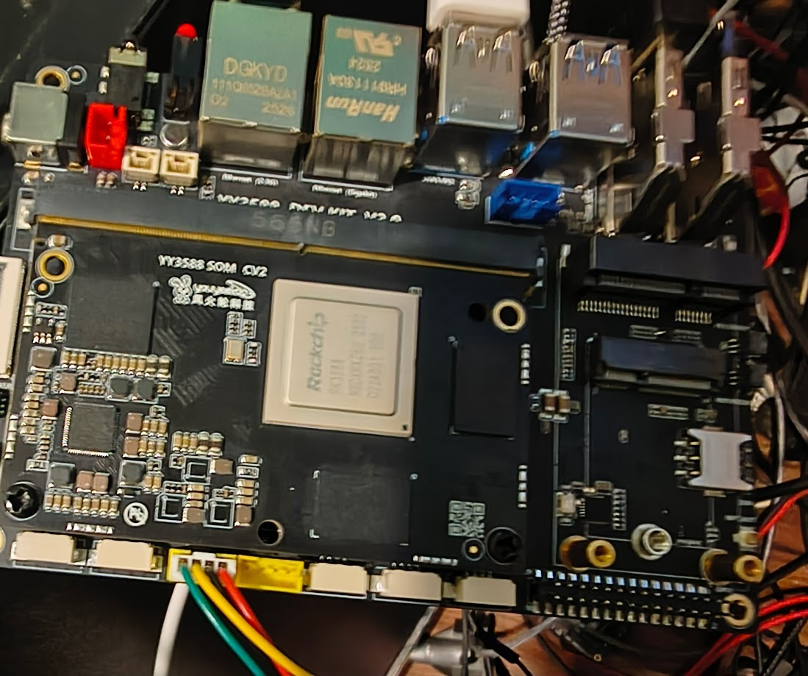

# yy3588-workspace

U-Boot-free firmware bring-up for the **youyeetoo YY3588** (Rockchip RK3588,
YY3588 SOM CV2 on the YY3588 DEV KIT V3.0 carrier), with the full debugging
record: handoff notes, serial logs and the scripts that build a one-shot
eMMC image.

    BootROM
      -> bt0        own first stage, Rust (DaveWK/oreboot, branch yy3588)
                    DRAM: rkbin DDR init today; own LPDDR4X init is WIP
      -> TF-A BL31  from source (or rkbin's prebuilt, YY3588_OPEN_TFA=false)
      -> EDK2       UEFI (DaveWK/edk2-rk3588, branch yy3588)
      -> systemd-boot -> vendor 6.1 kernel -> Debian 12

## Board status (2026-11-10)

- **SoM: works.** Debian boots from eMMC through this firmware: serial,
  adb over USB-C, HDMI, RTC, 32 GB LPDDR4X, 8 CPUs.
- **Carrier: faulty.** The 5 V rail `VCC5V0_SYS` (U21, NB679) starts and drops
  out or never starts, so USB-A and both USB hubs are dead; the gigabit PHY
  answers MDIO and makes its 125 MHz clock but passes no signal to or from the
  cable; the RTL8125 2.5G is not detected. Unchanged across every firmware
  variant, four 12 V supplies and the stock Android image (table in
  [docs/handoff-2026-11-10-night.md](docs/handoff-2026-11-10-night.md)).
- **Open item from youyeetoo support (2026-11-11):** measure the 3.3 V output
  of the **NB680GD (U2, `VCC3V3_SYS`)**; no 3.3 V there means U2 has failed.
  Board is powered off until then.

### J43 debug UART: wire it like this

*Photo taken 2026-11-10 17:16, before the 17:22 rewiring: it shows where J43
is, not how to wire it. Use the table.*

J43 (4-pin, board edge toward you), **left to right**:

| Pin (left → right) | Signal | Adapter |
|---|---|---|
| 4 (leftmost) | **VCC3V3_SYS (3.3 V rail)** | **leave unconnected** |
| 3 | RX (board) | adapter TX |
| 2 | TX (board) | adapter RX |
| 1 (rightmost) | **GND** | adapter GND |

1500000 8N1 (`scripts/serial-log.sh`). Until 2026-11-10 17:22 the adapter
ground sat on the leftmost pin, i.e. on the 3.3 V rail; with USB-C also on the
PC that shorted `VCC3V3_SYS` to ground, which explains the resets and the
"intermittent" rail earlier in the logs.

## Build

    git clone --recurse-submodules https://github.com/DaveWK/yy3588-workspace.git
    cd yy3588-workspace
    podman build -t yy3588-build -f Containerfile .
    podman run --rm --userns=keep-id --security-opt label=disable \
      -v "$PWD":/w -w /w yy3588-build make yy3588-rkbin-ddr yy3588-loader

`Containerfile` lists the host dependencies (Fedora 44: aarch64 cross GCC,
EDK2 BaseTools deps, `iasl`, `dtc`, Rust 1.99.0 via rustup) if you build
without a container. The bt0 crates have no registry dependencies.

| Target | Output in `out/yy3588/` |
|---|---|
| `make yy3588-bt0` | `yy3588-bt0.bin`, `idblock.bin` (bt0 from SRAM, no DDR init) |
| `make yy3588` | `YY3588_skeleton_<T>.img`: bt0 only; stops after console and PMIC report (own DDR init not built in) |
| `make yy3588-rkbin-ddr` | `YY3588_rkbinddr_<T>.img`: **DEV ONLY, contains the rkbin DDR blob**; rkbin DDR init → bt0 → BL31 → EDK2, the image that boots |
| `make yy3588-loader` | MaskROM RAM loaders for `rkdeveloptool db`: `_fastboot_loader.bin` (fastboot on USB-C), `_draminfo_loader.bin` (+ rail dump), `_boot_loader.bin` |

`<T>` is `YY3588_TARGET` (`DEBUG` default, or `RELEASE`). The images run on
the board on 2026-11-10 were `DEBUG` with `YY3588_OPEN_TFA=false` (rkbin
BL31 v1.56) and `YY3588_IDBLOCK_FEATURES=stepping-stone,diag`.

The firmware image is the 0..~8 MiB region of the eMMC: idblock at 32 KiB,
FIT (BL31 + EDK2) at 1 MiB, UEFI variables at 0x7C0000.

## Full eMMC image

`scripts/mk-full-image.sh` builds a one-shot image (firmware + ESP with
systemd-boot and the vendor kernel + Debian rootfs) and its Android sparse
form, with no root and no loop mounts:

    scripts/mk-full-image.sh out/yy3588/YY3588_rkbinddr_DEBUG.img \
      <vendor Image> <vendor rk3588-yyt.dtb> <rootfs.img> <systemd-bootaa64.efi> \
      out/yy3588-debian12-uefi.img

The kernel, DTB and rootfs come from the youyeetoo Linux SDK
([docs/vendor-sources.md](docs/vendor-sources.md)). `scripts/mk-yy3588-dtb.sh`
patches the vendor DTB for UEFI boot (console ttyS2, FIQ debugger off, GMAC1
clock input from the PHY). `scripts/mk-fw-simg.py` makes a firmware-only
sparse image that keeps the partitions.

## Flash

Recovery button held at power-on → MaskROM, USB-C to the PC:

    rkdeveloptool db out/yy3588/YY3588_rkbinddr_fastboot_loader.bin
    fastboot getvar carrier; fastboot getvar pmic       # rail state, no serial needed
    fastboot flash emmc out/yy3588-debian12-uefi.simg   # or a firmware-only .simg
    fastboot reboot

MaskROM is always reachable; `rkdeveloptool ef` plus the vendor image restores
stock. Switch 12 V at the wall with the barrel already plugged in (inserting a
live plug gives an aborted first start).

## Layout

| Path | What |
|---|---|
| `firmware/oreboot` | DaveWK/oreboot `yy3588`: bt0, crates, idblock/loader packers in `src/mainboard/youyeetoo/yy3588/` |
| `firmware/edk2-rk3588` | DaveWK/edk2-rk3588 `yy3588`: `Platform/Youyeetoo/YY3588`, RK806/RK860x ramp-rate fix, external-idblock build; its `edk2` and `edk2-platforms` submodules are DaveWK forks, branch `yy3588` |
| `scripts/` | image builders, DTB patcher, serial logger |
| `docs/` | handoffs and investigation notes ([docs/README.md](docs/README.md)) |
| `serial-logs/` | every UART/adb capture of the bring-up (large ones `.xz`) |
| `Containerfile`, `Makefile` | build |

## Licence

Scripts and Makefile: GPL-2.0-only (`LICENSE`). The submodules carry their
own licences. The rkbin DDR init and BL31 blobs are Rockchip's (rkbin
`LICENSE`); the `-rkbin-ddr` and loader outputs contain them and are for
development only. youyeetoo's schematic, PCB and mechanical files are not
included; get them from <https://wiki.youyeetoo.com/en/YY3588>.
